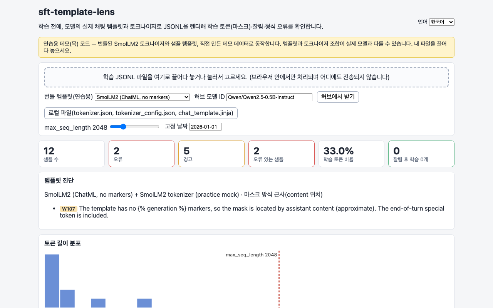
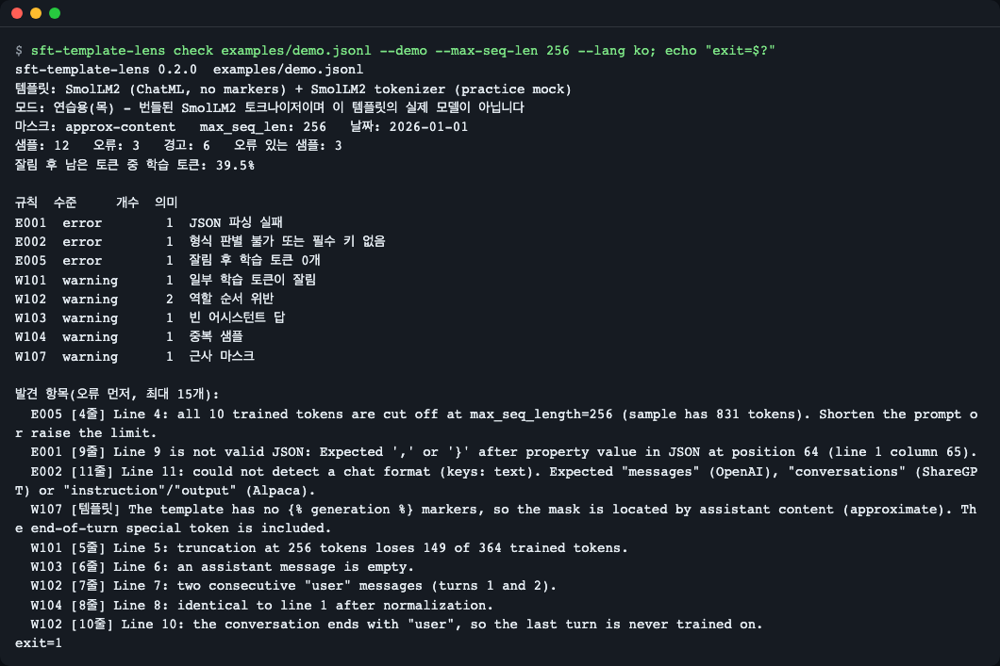
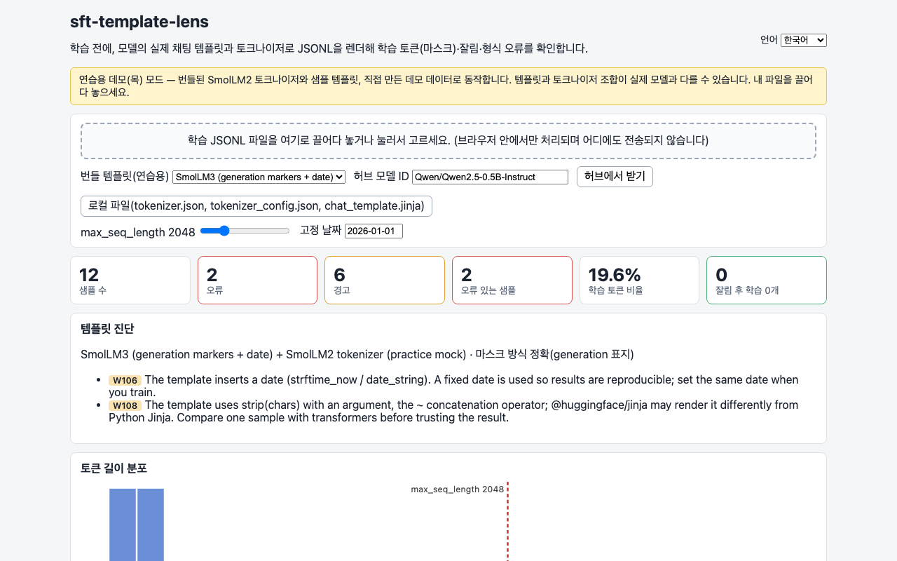
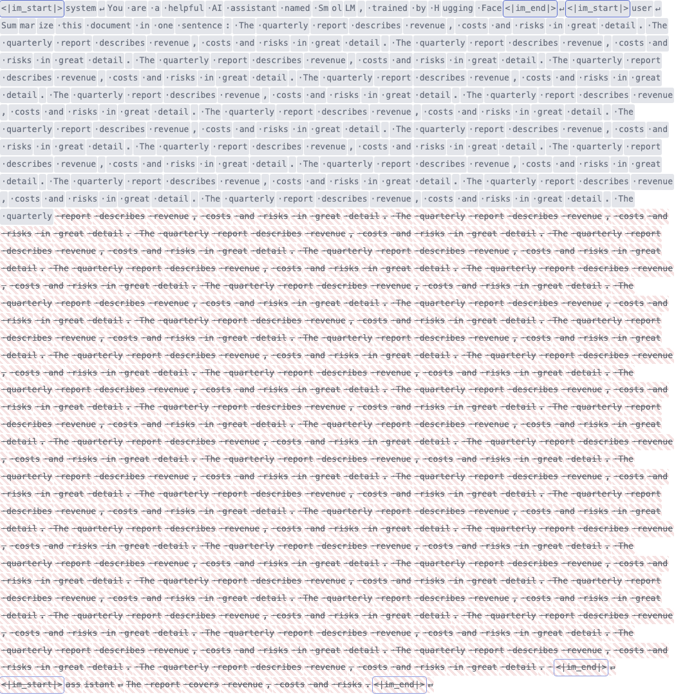
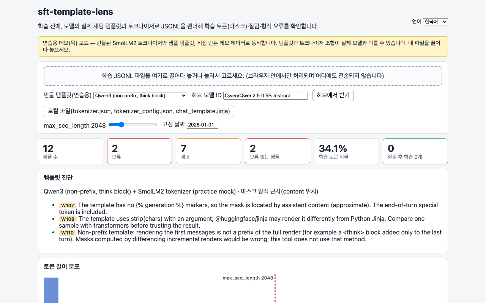
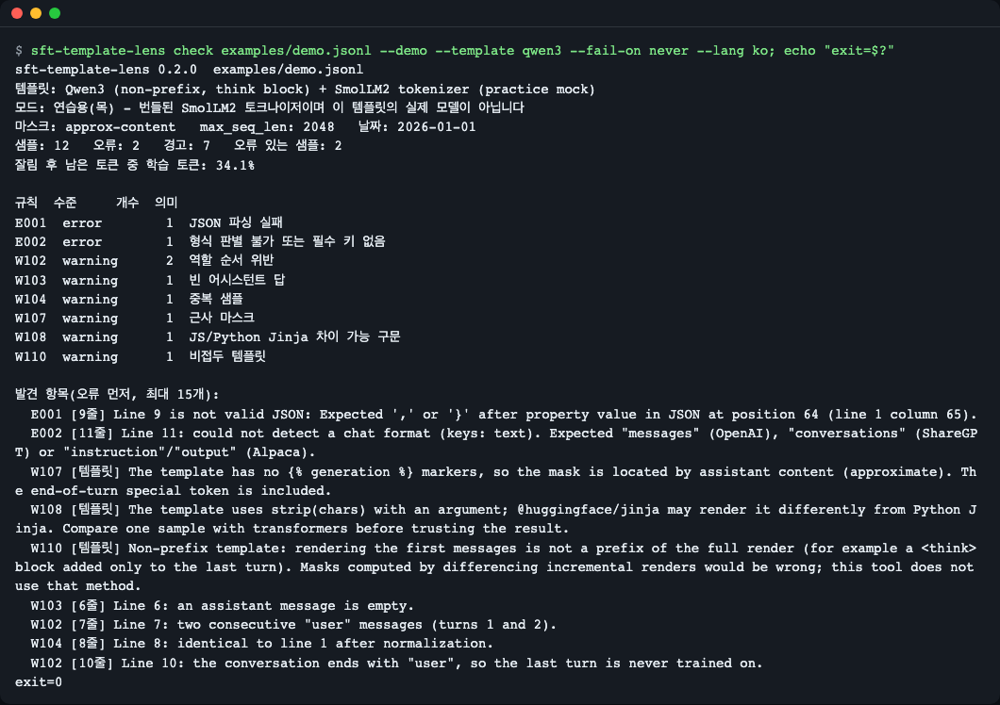
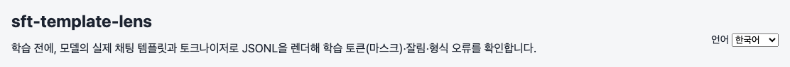
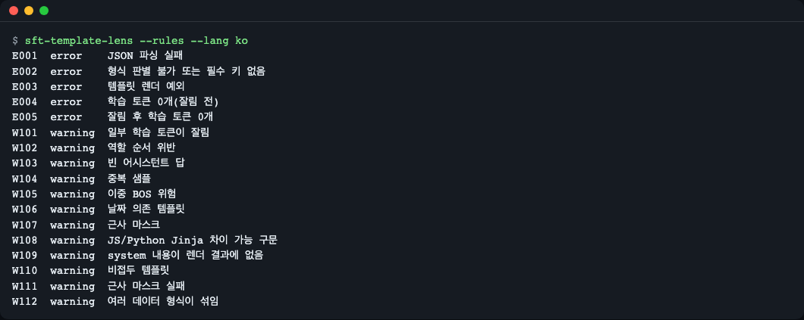
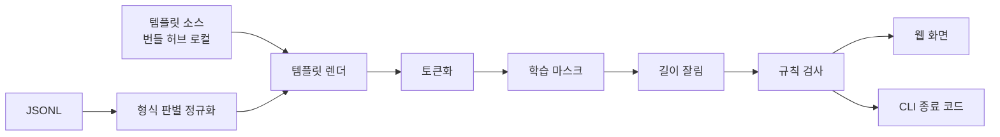

# sft-template-lens

[English](README.md) | **한국어**

파인튜닝 학습 파일(JSONL)을 모델의 **실제 채팅 템플릿과 토크나이저로 미리 렌더**해서, 어떤 토큰이 학습되는지, 어느 샘플이 길이 제한에 잘려 정답을 잃는지, 어느 줄이 템플릿 오류를 내는지를 학습 전에 보여 주는 도구입니다. 웹 화면(브라우저 안에서만 처리)과 CLI(CI용)가 같은 검사 엔진을 씁니다.


*연습용 데모 데이터 12줄을 검사한 첫 화면. 위쪽 띠는 "연습용 목(mock) 모드"임을 알려 줍니다.*

## 이런 분께

- LoRA·SFT 를 직접 돌리는데, 학습을 한 번 돌려 봐야 "손실 0"·"라벨 전부 -100"이 드러나서 시간을 잃은 분
- 모델을 바꿨을 때(예: Qwen2.5 에서 Qwen3 로) 채팅 템플릿이 달라져 데이터가 어떻게 렌더되는지 확인하고 싶은 분
- 데이터셋 PR 이 들어올 때 CI 에서 형식 오류를 자동으로 걸러 내고 싶은 분

## 왜 필요한가: 교정쇄 비유

인쇄소에 원고를 넘기기 전에 실제 판형으로 짠 **교정쇄**를 받아 보듯이, 학습 전에 데이터를 실제 템플릿으로 한 번 짜 보는 도구입니다.

- 원고 = JSONL, 판형 = 채팅 템플릿, 활자 = 토크나이저
- 빨간 펜을 맞을 부분 = 학습되는 토큰(어시스턴트 답)
- 판 밖으로 밀려나는 줄 = `max_seq_length` 에 잘리는 토큰

학습 전에 잡고 싶은 실패는 네 가지입니다.

| 실패 | 학습 중 보이는 모습 | 이 도구의 표시 |
|---|---|---|
| 학습 토큰이 0개 | 손실 0, 라벨이 전부 -100 | E004, E005 |
| 정답이 길이 제한에 잘림 | 긴 프롬프트 샘플이 조용히 무의미해짐 | E005, W101 |
| 템플릿이 역할을 거부 | `System role not supported` 같은 예외 | E003 |
| 줄이 깨졌거나 형식이 다름 | `KeyError: role` 등 | E001, E002 |

## 설치

전제: Node.js 22.12.0 이상(`node --version` 으로 확인). 설치는 `brew install node`(macOS) 또는 [nodejs.org](https://nodejs.org/)에서 하세요. 최소 리눅스 환경에서는 `git` 과 Node.js 만 있으면 됩니다. Python 은 필요 없습니다.

```bash
git clone https://github.com/LeeGyeongPil/sft-template-lens.git
cd sft-template-lens
npm ci
```

아직 npm 레지스트리에는 올리지 않았습니다(`npx sft-template-lens` 는 게시 후에 가능).

## 빠르게 시작하기 (30초)

웹 화면: 정적 단일 파일로 빌드해서 브라우저로 엽니다. 서버가 필요 없습니다.

```bash
npm run build
npm run check:static
```

```text
static ok: single file, 0 external refs; gitignore ok
```

(`gitignore ok` 는 git 저장소 안에서 실행할 때만 나옵니다. 압축 파일로 받은 폴더처럼 git 저장소가 아니면 `gitignore check skipped (not a git checkout)` 가 대신 나옵니다.)

`dist/index.html` 을 브라우저로 열면 됩니다(`file://` 로 열려요). 개발 서버를 쓰려면 `npm start`. 화면은 브라우저 언어로 시작하며(`ko` 로 시작하면 한국어, 아니면 영어), 헤더의 언어 메뉴로 바꿀 수 있습니다([사용법](#사용법) 참고).

CLI: 번들된 연습용 데이터를 검사합니다. 오류가 있으면 종료 코드가 1 입니다.

```bash
npm run build:cli
node dist-cli/cli.mjs check examples/demo.jsonl --demo --max-seq-len 256 --lang ko; echo "exit=$?"
```

```text
sft-template-lens 0.2.0  examples/demo.jsonl
템플릿: SmolLM2 (ChatML, no markers) + SmolLM2 tokenizer (practice mock)
모드: 연습용(목) - 번들된 SmolLM2 토크나이저이며 이 템플릿의 실제 모델이 아닙니다
마스크: approx-content   max_seq_len: 256   날짜: 2026-01-01
샘플: 12   오류: 3   경고: 6   오류 있는 샘플: 3
잘림 후 남은 토큰 중 학습 토큰: 39.5%

규칙  수준     개수  의미
E001  error        1  JSON 파싱 실패
E002  error        1  형식 판별 불가 또는 필수 키 없음
E005  error        1  잘림 후 학습 토큰 0개
W101  warning      1  일부 학습 토큰이 잘림
W102  warning      2  역할 순서 위반
W103  warning      1  빈 어시스턴트 답
W104  warning      1  중복 샘플
W107  warning      1  근사 마스크

발견 항목(오류 먼저, 최대 15개):
  E005 [4줄] Line 4: all 10 trained tokens are cut off at max_seq_length=256 (sample has 831 tokens). Shorten the prompt or raise the limit.
  ...
exit=1
```

(`...` 는 줄여 쓴 부분입니다. 실제로는 15개까지 나옵니다. 발견 항목의 문장은 `--json` 과 같은 기계용 영어 문장이라 한국어 출력에서도 영어입니다.)


*같은 검사의 터미널 화면. 오류가 있어서 종료 코드가 1 입니다.*

참고: 이 화면(05·06·08)의 프롬프트는 `sft-template-lens check ...` 로 보입니다. 이 이름은 npm 으로 설치했을 때 쓰는 명령(bin)이고, 소스를 clone 해서 쓸 때는 같은 인자로 `node dist-cli/cli.mjs check ...` 를 실행합니다. 두 방식은 같은 코드를 실행하며 출력도 같습니다.

## 사용법

### 1. 화면 둘러보기

URL 해시로 화면 상태를 지정할 수 있습니다: `dist/index.html#template=<이름>&sample=<줄 번호>&max=<토큰 수>`. 샘플 번호는 JSONL 의 **줄 번호**(1부터, 깨진 줄 포함)입니다.

**(a) 어시스턴트 턴만 정확히 학습되는 템플릿** — `#template=smollm3&sample=1`


*초록이 학습되는 토큰, 회색이 마스크된 토큰입니다. 배지 "마스크 정확"은 템플릿에 `` 표지가 있다는 뜻입니다.*

**(b) 길이 제한에 정답이 잘리는 샘플** — `#template=smollm2&sample=4&max=256`


*(토큰 색칠 영역만 잘라 보여 줍니다.) 긴 프롬프트가 256 토큰을 넘어, 오른쪽부터 잘리는 영역(빗금·흐림)에 정답이 전부 들어갑니다. 학습 토큰 0개이므로 E005 입니다.*

**(c) 템플릿이 바뀌면 같은 대화도 달라진다** — `#template=qwen3&sample=2`


*Qwen3 템플릿은 마지막 어시스턴트 턴에만 `<think>` 블록을 붙입니다(W110). 표지가 없어서 배지는 "마스크 근사"입니다.*

### 2. 내 데이터·내 모델로 검사

- 화면에 `train.jsonl` 을 끌어다 놓으면 형식(OpenAI `messages`, ShareGPT `conversations`, Alpaca `instruction/output`)을 자동으로 판별합니다. 데이터는 브라우저 메모리에서만 처리하며 어디에도 보내지 않습니다.
- 템플릿 소스는 세 가지입니다. 번들 목, 허브 모델 ID(예: `Qwen/Qwen2.5-0.5B-Instruct`, 모델 파일만 요청), 로컬 파일(`tokenizer.json`, `tokenizer_config.json`, `chat_template.jinja`). 별도 `chat_template.jinja` 가 있으면 그쪽이 우선입니다.
- 게이트 모델(예: `google/gemma-2-2b-it`)은 인증이 없으면 401 이므로 안내 메시지가 뜹니다. 로컬 파일을 올리거나 비게이트 미러를 쓰세요. 이 버전은 토큰 입력을 지원하지 않습니다.
- 실제 모드(허브)는 `tokenizer.json` 이 수 MB 에서 십수 MB 라 네트워크 상태에 따라 느릴 수 있습니다(공유 자원 사용). 목 모드는 오프라인이라 즉시 끝납니다.

### 3. CLI 와 CI

```bash
# 허브 모델로 (공개 모델)
NODE_USE_ENV_PROXY=1 node dist-cli/cli.mjs check data/train.jsonl --model Qwen/Qwen2.5-0.5B-Instruct

# 로컬 폴더의 파일로
node dist-cli/cli.mjs check data/train.jsonl --template-dir ./tok --max-seq-len 2048

# 1번 줄 샘플의 토큰별 학습/마스크를 색으로 보기 (초록 = 학습)
node dist-cli/cli.mjs check examples/demo.jsonl --demo --show 1 --fail-on never
```

`NODE_USE_ENV_PROXY=1` 은 프록시 환경에서만 필요합니다. 위 예의 `--show` 값은 소스 줄 번호입니다. 색은 ANSI 이스케이프로 출력되므로 색을 지원하는 터미널에서 보세요.

| 옵션 | 뜻 |
|---|---|
| `--demo` [`--template <이름>`] | 번들 연습용 목. `--template` 은 `--demo` 와 함께만 동작(기본 `smollm2`). 이름: `smollm2`, `smollm3`, `qwen2_5`, `qwen3`, `system-unsupported` |
| `--template-dir <폴더>` | 로컬 `tokenizer.json`, `tokenizer_config.json`, `chat_template.jinja` |
| `--model <소유자/이름>` | 공개 허브 모델 |
| `--max-seq-len <n>` | 오른쪽 잘림 기준(기본 2048) |
| `--date <YYYY-MM-DD>` | 날짜를 찍는 템플릿용 고정 날짜(기본 2026-01-01) |
| `--fail-on error\|warning\|never` | 종료 코드 1 의 기준(기본 error) |
| `--json` | 요약과 결과를 JSON 으로 |
| `--show <줄 번호>` | 그 소스 줄 샘플의 토큰별 학습/마스크를 ANSI 색으로 출력(초록 = 학습, 회색 = 마스크, 흐린 취소선 = `--max-seq-len` 으로 잘림). 줄바꿈 토큰은 `↵` 로 표시. 파일에 없는 줄 번호(빈 줄 포함)면 종료 코드 2. 깨진 줄은 렌더되지 않았다는 안내만 나오고, 종료 코드는 `--fail-on` 기준을 따름 |
| `--out-clean <경로>` | 오류 없는 샘플을 `{"messages": [...]}` JSONL 로 저장 |
| `--out-issues <경로>` | 모든 결과를 JSONL 로 저장 |
| `--rules` | 규칙 목록 출력 |
| `--lang en\|ko` | 도구 자체 메시지(도움말·요약·토큰 보기·`--rules`·오류)의 언어. [4. 언어 고르기](#4-언어-고르기) 참고 |

종료 코드: 0 정상, 1 기준 이상의 발견, 2 사용법·로딩 오류. 빈 파일(또는 빈 줄만 있는 파일)도 경로를 잘못 준 것으로 보고 2 로 끝나며 `The file has no JSONL rows. Check the path, or write one JSON object per line.` 를 출력합니다. `.json` 배열 파일은 `jq -c ".[]" in.json > out.jsonl` 로 JSONL 로 바꾸세요.

GitHub Actions 에서 데이터셋 PR 을 검사하는 예:

```yaml
- uses: actions/setup-node@v7.1.0
  with:
    node-version: "22.12.0"
- run: npm ci && npm run build:cli
- run: node dist-cli/cli.mjs check data/train.jsonl --template-dir ./tok --max-seq-len 2048
```

템플릿을 바꿔 보면 같은 데이터에서 경고가 달라집니다.

```bash
node dist-cli/cli.mjs check examples/demo.jsonl --demo --template qwen3 --fail-on never --lang ko; echo "exit=$?"
```


*기본 템플릿과 비교해 W108, W110 이 추가로 뜹니다(W107 은 둘 다 표지가 없어서 공통). `--fail-on never` 라서 종료 코드는 0 입니다.*

### 4. 언어 고르기

웹 화면과 CLI 모두 영어와 한국어를 지원합니다.

**웹**: 헤더의 언어 메뉴(English / 한국어)로 고릅니다. 고른 값은 브라우저(`localStorage` 키 `sft-template-lens.lang`)에 저장돼 새로고침해도 유지됩니다. 저장된 값이 없는 첫 방문에만 브라우저 언어를 따라 `ko` 로 시작하면 한국어, 아니면 영어로 뜹니다. `<html lang>` 도 선택에 맞춰 바뀝니다. 규칙 이름도 두 언어로 나오며 규칙 ID(`E001`, `W101` …)는 바뀌지 않습니다.


*같은 화면의 헤더에서 메뉴를 한국어로 둔 모습. 제목 오른쪽의 "언어" 드롭다운이 메뉴입니다.*

**CLI**: 아래 순서로 언어를 정하며, 먼저 설정된 것이 이깁니다.

1. `--lang en|ko`
2. 환경변수 `SFT_TEMPLATE_LENS_LANG`
3. `LC_ALL`
4. `LC_MESSAGES`
5. `LANG`

`ko` 로 시작하는 값(예: `ko_KR.UTF-8`)이면 한국어, 그 밖(환경변수의 알 수 없는 값 포함)은 영어입니다. `--lang` 은 `en` 또는 `ko` 만 받으며 다른 값은 종료 코드 2 로 끝납니다.

```bash
node dist-cli/cli.mjs --rules --lang ko
SFT_TEMPLATE_LENS_LANG=ko node dist-cli/cli.mjs check examples/demo.jsonl --demo --fail-on never
```


*`--rules --lang ko` 는 규칙 목록을 한국어로 보여 줍니다. `--lang en` 이면 같은 목록이 영어로 나옵니다.*

도구 자체 메시지만 번역됩니다. `--json`, `--out-clean`, `--out-issues`, 규칙 ID, 발견 항목 문장은 항상 영어이고 두 언어에서 같으므로 기계가 읽는 쪽은 영향이 없습니다. CI 스크립트가 사람용 출력 문구를 매칭한다면 `LANG` 이 한국어일 때 출력이 한국어가 되므로 `--lang en`(또는 `SFT_TEMPLATE_LENS_LANG=en`)으로 고정하세요.

## 검사 규칙

규칙 ID 는 CI 에서 매칭할 수 있도록 바꾸지 않습니다(`node dist-cli/cli.mjs --rules` 로도 볼 수 있음).

| ID | 수준 | 뜻 |
|---|---|---|
| E001 | 오류 | JSON 파싱 실패(줄 번호 포함, 나머지 줄은 계속 처리) |
| E002 | 오류 | 형식 판별 불가 또는 필수 키 없음 |
| E003 | 오류 | 템플릿 렌더 예외(예: system 미지원 템플릿) |
| E004 | 오류 | 학습 토큰 0개(잘림 전) |
| E005 | 오류 | 잘림 후 학습 토큰 0개 |
| W101 | 경고 | 일부 학습 토큰이 잘림(잃은 개수 표시) |
| W102 | 경고 | 역할 순서 위반(같은 역할 연속, 마지막이 assistant 아님) |
| W103 | 경고 | 빈 어시스턴트 답 |
| W104 | 경고 | 중복 샘플(정규화 후 같음) |
| W105 | 경고 | 이중 BOS 위험 |
| W106 | 경고 | 날짜 의존 템플릿(고정 날짜로 렌더) |
| W107 | 경고 | 근사 마스크(generation 표지 없음) |
| W108 | 경고 | JS 와 Python Jinja 에서 다를 수 있는 구문 사용 |
| W109 | 경고 | system 내용이 렌더 결과에 없음(템플릿이 조용히 버림) |
| W110 | 경고 | 비접두 템플릿 |
| W111 | 경고 | 근사 마스크 계산 실패(마스크를 숨기고 이유 표시) |
| W112 | 경고 | 여러 데이터 형식이 섞임 |

## 동작 원리



1. **형식 판별 정규화**: 세 가지 형식을 모두 `role`/`content` 목록으로 바꿉니다.
2. **템플릿 렌더**: `@huggingface/jinja` 로 모델의 채팅 템플릿을 그대로 렌더해 문자열을 만듭니다. 날짜를 찍는 템플릿(`strftime_now`)은 고정 날짜를 씁니다. 그래서 한국어 로캘·서울 시간대에서도 같은 결과입니다.
3. **토큰화**: `@huggingface/tokenizers` 로 `add_special_tokens=false` 로 인코딩합니다(템플릿이 이미 특수 토큰을 넣기 때문).
4. **학습 마스크**:
   - 정확(`exact-generation`): 템플릿에 `` 표지가 있으면 그 구간만 학습합니다. TRL 의 `assistant_only_loss` 와 같은 결과를 노립니다.
   - 근사(`approx-content`): 표지가 없으면 어시스턴트 content 앞뒤에 보이지 않는 표식 문자를 넣어 대화 전체를 **한 번만** 렌더하고 위치를 찾습니다. 턴 끝 특수 토큰(예: `<|im_end|>`)까지 포함합니다. 표식을 지운 결과가 일반 렌더와 다르면 W111 로 마스크를 숨깁니다.
   - 메시지를 하나씩 덧붙여 렌더한 차이로 마스크를 만드는 방식은 쓰지 않습니다. Qwen3 처럼 마지막 턴에만 `<think>` 를 붙이는 템플릿에서 틀리기 때문입니다(그 사실은 W110 으로 알려 줍니다).
5. **길이 잘림**: `max_seq_length` 로 오른쪽부터 자른 뒤 남는 학습 토큰 수를 셉니다. 0 이면 E005 입니다.

## 연습용 목(mock) 모드

설치 없이 바로 써 보도록, 아래 파일을 레포에 넣어 두었습니다(출처·커밋은 `fixtures/README.md`). 아래 중 직접 작성한 템플릿을 뺀 나머지는 Apache-2.0 이고, 전문은 `LICENSES/Apache-2.0.txt` 에 있습니다.

- SmolLM2-135M-Instruct 의 토크나이저: 일부 어휘 항목을 뺀 **수정본**이라 일부 영어 단어의 토큰 수가 원본과 1~2개 다를 수 있습니다(`fixtures/README.md`).
- 실제 공개 채팅 템플릿 4종(SmolLM2, SmolLM3, Qwen2.5, Qwen3)
- Gemma 2 의 system 예외를 흉내 낸 직접 작성 템플릿(`system-unsupported.jinja`): 이 레포 라이선스(MIT)입니다.

가짜 출력이 아니라 **실제 Jinja 렌더와 실제 BPE 토큰화**를 하지만, 모든 템플릿을 SmolLM2 토크나이저로 토큰화합니다. 그래서 Qwen·SmolLM3 템플릿의 토큰 수는 진짜 모델과 다를 수 있습니다. 실제 수치는 허브나 로컬 모드로 확인하세요. Llama·Gemma 템플릿은 라이선스 때문에 번들하지 않습니다.

## 알려진 한계

- **브라우저 확인**: 이 화면은 빌드 검사와 가상 DOM 테스트(happy-dom)로 확인했습니다. 실제 브라우저에서의 모양은 스크린샷으로 별도로 확인합니다.
- **Python 과의 토크나이저 차이**: transformers 5.22.2 의 `GPT2Tokenizer` 는 `tokenizer.json` 의 숫자 분리(Digits) 설정을 무시합니다. SmolLM2 에서 `"\n\n6"` 은 Python transformers 가 `[198,198,38]`, Rust `tokenizers` 와 이 도구는 `[1116,38]` 입니다. 이 도구의 기준값은 `tokenizer.json` 을 직접 읽는 Rust `tokenizers` 입니다. 학습에 transformers 의 `GPT2Tokenizer` 를 쓰면 숫자가 있는 텍스트의 토큰 수가 조금 다를 수 있습니다.
- **Jinja 구현 차이**: `@huggingface/jinja` 와 Python Jinja 가 일부 구문에서 다를 수 있습니다(W108 이 위험 구문을 알려 줍니다). Python 과 렌더 대조를 한 것은 번들 템플릿 4종뿐입니다.
- **게이트 모델**: 인증이 필요한 모델은 401 이 나며 토큰 입력은 아직 없습니다. 로컬 파일을 쓰세요.
- **근사 마스크**: 템플릿이 넣는 `<think>\n\n</think>` 같은 블록은 content 밖이라 학습 표시에 들어가지 않습니다.
- **고정 날짜**: 날짜를 찍는 템플릿은 `--date`(기본 2026-01-01)로 렌더합니다. 실제 학습 라이브러리가 쓰는 날짜와 다를 수 있습니다.
- **발견 항목 문장은 영어 그대로**: 각 발견 항목의 문장(예: `Line 4: all 10 trained tokens are cut off ...`)은 검사 엔진이 만드는 기계용 문자열이라 `--json`·`issues.jsonl` 과 같게 두 언어 모두 번역하지 않습니다.
- **오류 상세는 일부만 번역됨**: 대부분의 오류 메시지(잘못된 파일·옵션 등)는 모두 번역됩니다. 템플릿 파싱 오류, 토크나이저 로드 오류, 알 수 없는 오류는 앞 문장만 선택한 언어를 따르고 뒤따르는 원인은 하위 라이브러리가 낸 영어 원문 그대로입니다. 그래서 한국어로 실행해도 한국어 문장 뒤에 영어 원인이 붙을 수 있습니다. 프록시 설정 없이 네트워크가 막힌 경우(예: `fetch failed`)도 여기에 속합니다. 한국어 실행은 한국어 문장 뒤에 영어 원인이 붙고, 영어 실행은 `Error: fetch failed` 만 나옵니다. 프록시 힌트 줄은 두 언어 모두 맞게 나옵니다.
- **허브 오류 문구**: 게이트 모델 안내만 `Error:`(대문자)로 시작하고 다른 오류는 `error:` 로 시작하므로 CI 에서는 접두 대신 종료 코드(2)로 판단하세요. 존재하지 않는 모델 ID 도 허브가 둘 다 401 을 주기 때문에 같은 게이트·비공개 안내로 나옵니다. ID 철자를 확인하세요.
- **`--show` 와 `--json`**: 함께 쓰면 JSON 뒤에 색 토큰 출력이 같은 stdout 에 붙어 전체가 유효한 JSON 이 아닙니다. 따로 실행하세요. 옵션 표에 `-h/--help`, `-v/--version` 행은 아직 없습니다.
- **범위 밖**: 멀티모달(이미지 토큰), 도구 호출 메시지의 정밀 마스크, `prompt`/`completion` 형식, 웹 워커(수십만 줄), TRL 학습용 템플릿 자동 교체.
- Node 22.12.0 은 CI 매트릭스에서 확인하는 대상입니다(작성 환경은 Node 26).

## 언제 쓰나

- 학습 전에 데이터셋 전체를 실제 템플릿·토크나이저로 렌더해 학습 토큰 0개, 잘림, 템플릿 오류를 미리 보고 싶을 때, 또는 CI 에서 같은 검사를 돌리고 싶을 때 이 도구가 맞습니다(이 도구는 템플릿·토크나이저·잘림까지만 재현합니다).
- 실제 학습 설정의 collator·패킹까지 반영한 확인이 필요하면 [Axolotl `preprocess`](https://docs.axolotl.ai/docs/cli.html) 나 [TRL](https://huggingface.co/docs/trl/chat_templates) 을 쓰세요. 한 대화만 빠르게 렌더하려면 [HF chat-template-playground](https://huggingface.co/spaces/huggingfacejs/chat-template-playground) 가 간편합니다.

(조회일 2026-11-10)

## 자주 겪는 문제

| 증상 | 원인 | 해결 |
|---|---|---|
| 허브 ID 입력 후 401 안내가 뜸 | 게이트(승인 필요) 모델 | 로컬 `tokenizer.json`, `tokenizer_config.json`, `chat_template.jinja` 를 올리거나 비게이트 미러 사용 |
| 짧은 샘플까지 E005 가 많이 나옴 | 템플릿이 붙이는 기본 시스템 프롬프트가 길어서 `--max-seq-len` 을 넘기는 경우(예: SmolLM3 는 약 270 토큰이라 `--max-seq-len 256` 이면 정답이 잘림) | `--max-seq-len` 을 올림. 실제 학습에서도 같은 일이 일어납니다 |
| CLI 가 허브에 연결 못 함 | 프록시 환경 | `NODE_USE_ENV_PROXY=1` 을 앞에 붙임 |
| 마스크가 안 보이고 W111 | 템플릿이 content 를 가공해 근사 위치를 못 찾음 | 템플릿에 `` 표지를 넣거나 정확 마스크 템플릿 사용 |
| `npm test` 가 CLI 파일이 없다고 함 | CLI 빌드 전 | `npm test` 는 `pretest` 로 먼저 빌드합니다. 직접 `npx vitest` 를 쓰면 `npm run build:cli` 를 먼저 |
| CI·터미널에서 CLI 가 한국어로 나옴 | `LANG`·`LC_ALL`·`LC_MESSAGES` 가 `ko` 로 시작 | `--lang en` 을 주거나 `SFT_TEMPLATE_LENS_LANG=en` 으로 고정 |
| 템플릿에 날짜가 찍혀 학습 데이터가 매번 다름 | 날짜 의존 템플릿(W106) | `--date` 로 고정 |

## 개발·기여

```bash
npm ci
npm run typecheck
npm test            # 네트워크·Python 없이 동작. 91개 테스트
npm run build && npm run check:static
```

- 테스트는 번들 토크나이저와, 커밋된 기준값(`test/golden/parity.json`)을 씁니다. 기준값은 Python(transformers 5.22.2, jinja2 3.1.6, tokenizers 0.23.3)으로 `tools/golden/make_golden.py` 를 실행해 다시 만들 수 있습니다(`uv run --no-project --python 3.12 --with transformers==5.22.2 --with jinja2==3.1.6 python -I tools/golden/make_golden.py`).
- 검사 엔진은 `src/core`(DOM·Node API 없음), 웹 화면은 `src/ui`, CLI 는 `src/cli` 입니다.
- 의존성은 전부 정확한 버전으로 고정했습니다. 직접 쓰는 라이브러리: `@huggingface/jinja` 0.5.11, `@huggingface/tokenizers` 0.2.0, React 19.3.1.
- 취약점 신고는 [SECURITY.md](SECURITY.md) 를 보세요.

## 더 알아보기

- Hugging Face, Chat Templates: https://huggingface.co/docs/transformers/chat_templating
- TRL, Chat templates와 assistant_only_loss: https://huggingface.co/docs/trl/chat_templates
- Unsloth, 학습 오류와 해결: https://docs.unsloth.ai/basics/errors
- `@huggingface/jinja`: https://www.npmjs.com/package/@huggingface/jinja
- `@huggingface/tokenizers`: https://www.npmjs.com/package/@huggingface/tokenizers

## 라이선스

MIT (`LICENSE`). 번들한 모델 파일은 원래 라이선스(Apache-2.0, `LICENSES/Apache-2.0.txt`)를 따르며 `NOTICE`, `fixtures/README.md` 에 출처와 변경 내용을 적었습니다.
