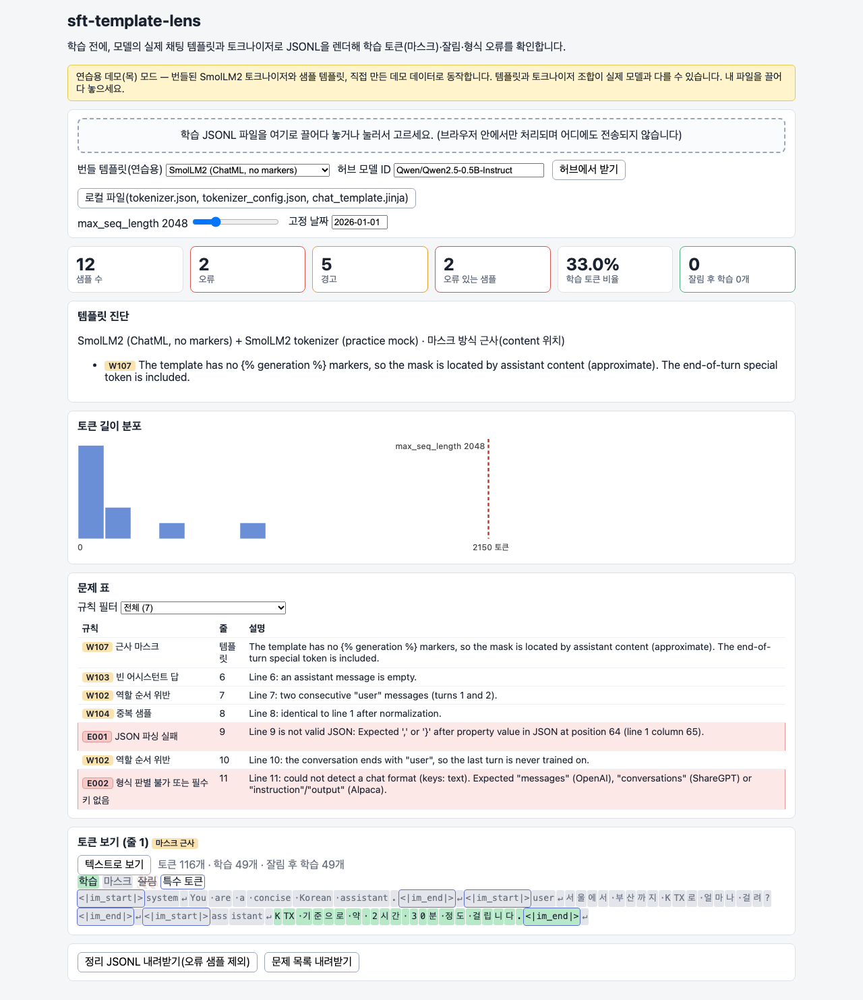
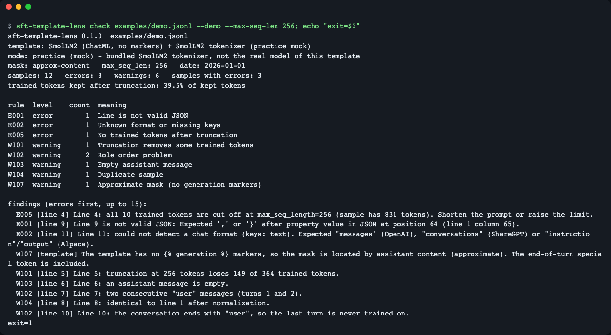
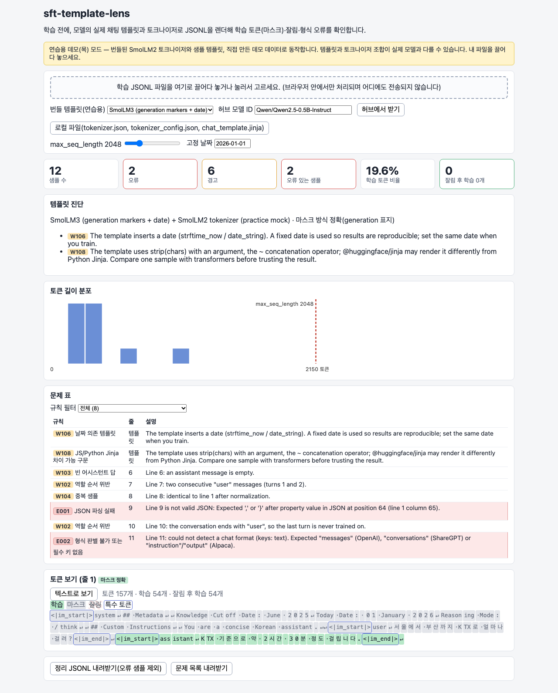
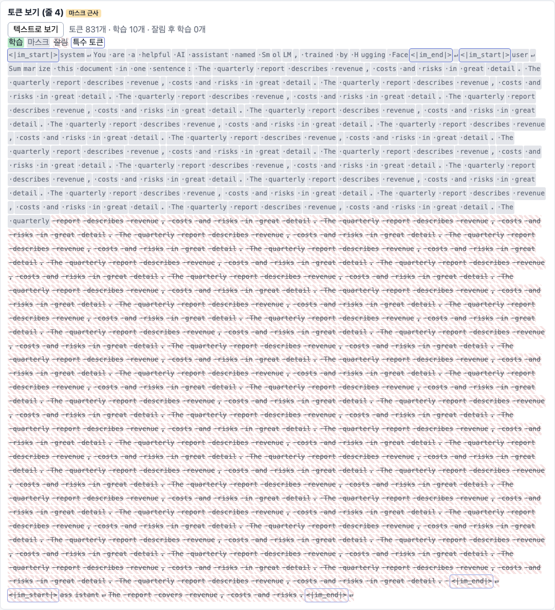
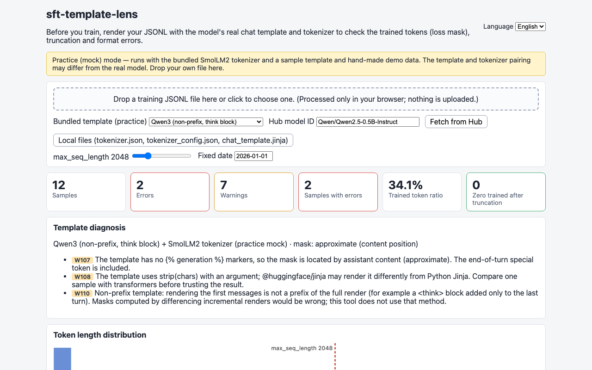
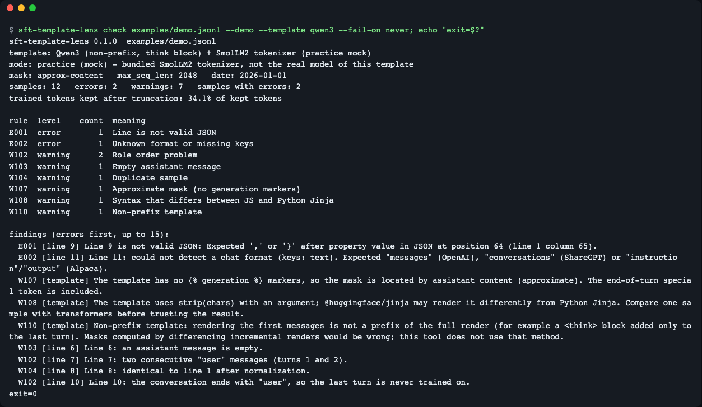
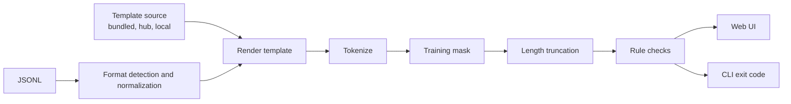

# sft-template-lens

**English** | [한국어](README.ko.md)

sft-template-lens renders your fine-tuning JSONL (OpenAI `messages`, ShareGPT or Alpaca) with a model's real chat template and tokenizer, then shows which tokens are trained (loss mask), which samples lose their answer to `max_seq_length` truncation, and which lines break the template. It is for people running LoRA/SFT who want to catch "loss is 0", "System role not supported" and "answer cut off" before training. The web UI runs fully in the browser (your data is never uploaded) and the Node CLI is for CI; both use the same checking engine: `npm ci && npm run build && open dist/index.html`, or `npm ci && npm run build:cli && node dist-cli/cli.mjs check data.jsonl --demo`.


*The first screen after checking 12 lines of practice demo data. The band at the top tells you it is "practice mock mode".*

## Who it is for

- People who run LoRA/SFT themselves and lose time because "loss 0" or "all labels -100" only shows up after launching a training run
- People who switch models (for example from Qwen2.5 to Qwen3) and want to see how the data renders when the chat template differs
- People who want CI to automatically filter out format errors when a dataset PR comes in

## Why you need it: the proof-sheet analogy

Just as you get a **proof** typeset in the real page format before handing a manuscript to the printer, this tool sets your data once with the real template before training.

- Manuscript = JSONL, page format = chat template, type = tokenizer
- The parts that get the red pen = trained tokens (the assistant's answers)
- Lines pushed off the page = tokens cut by `max_seq_length`

There are four failures to catch before training.

| Failure | What you see during training | This tool's flag |
|---|---|---|
| 0 trained tokens | Loss 0, all labels -100 | E004, E005 |
| The answer is cut by the length limit | Samples with long prompts silently become meaningless | E005, W101 |
| The template rejects a role | An exception such as `System role not supported` | E003 |
| A line is broken or in a different format | `KeyError: role` and the like | E001, E002 |

## Installation

Prerequisite: Node.js 22.12.0 or later (check with `node --version`). Install it with `brew install node` (macOS) or from [nodejs.org](https://nodejs.org/). In a minimal Linux environment you only need `git` and Node.js. Python is not needed.

```bash
git clone https://github.com/LeeGyeongPil/sft-template-lens.git
cd sft-template-lens
npm ci
```

It has not been published to the npm registry yet (`npx sft-template-lens` will be possible after publishing).

## Quick start (30 seconds)

Web UI: build it as a static single file and open it in a browser. No server is needed.

```bash
npm run build
npm run check:static
```

```text
static ok: single file, 0 external refs; gitignore ok
```

(`gitignore ok` appears only when run inside a git repository. If the folder is not a git repository, such as one downloaded as an archive, `gitignore check skipped (not a git checkout)` appears instead.)

Just open `dist/index.html` in a browser (it opens via `file://`). To use the development server, run `npm start`.

CLI: check the bundled practice data. If there are errors, the exit code is 1.

```bash
npm run build:cli
node dist-cli/cli.mjs check examples/demo.jsonl --demo --max-seq-len 256; echo "exit=$?"
```

```text
sft-template-lens 0.1.2  examples/demo.jsonl
template: SmolLM2 (ChatML, no markers) + SmolLM2 tokenizer (practice mock)
mode: practice (mock) - bundled SmolLM2 tokenizer, not the real model of this template
mask: approx-content   max_seq_len: 256   date: 2026-01-01
samples: 12   errors: 3   warnings: 6   samples with errors: 3
trained tokens kept after truncation: 39.5% of kept tokens

rule  level    count  meaning
E001  error        1  Line is not valid JSON
E002  error        1  Unknown format or missing keys
E005  error        1  No trained tokens after truncation
W101  warning      1  Truncation removes some trained tokens
W102  warning      2  Role order problem
W103  warning      1  Empty assistant message
W104  warning      1  Duplicate sample
W107  warning      1  Approximate mask (no generation markers)

findings (errors first, up to 15):
  E005 [line 4] Line 4: all 10 trained tokens are cut off at max_seq_length=256 (sample has 831 tokens). Shorten the prompt or raise the limit.
  ...
exit=1
```

(`...` marks an abridged part. In reality up to 15 are printed.)


*The terminal view of the same check. There are errors, so the exit code is 1. (The image is from version 0.1.0, so it shows 0.1.0 as the version.)*

Note: the prompt in these screens (05 and 06) looks like `sft-template-lens check ...`. That name is the command (bin) used when installed through npm; when using a cloned source, run `node dist-cli/cli.mjs check ...` with the same arguments. Both ways run the same code and produce the same output.

## Usage

### 1. A tour of the screen

You can set the screen state with the URL hash: `dist/index.html#template=<name>&sample=<line number>&max=<token count>`. The sample number is the JSONL **line number** (from 1, including broken lines).

**(a) A template where only the assistant turns are trained exactly** — `#template=smollm3&sample=1`


*Green marks trained tokens and gray marks masked tokens. The "exact mask" badge means the template has `` markers.*

**(b) A sample whose answer is cut by the length limit** — `#template=smollm2&sample=4&max=256`


*(Only the token-coloring area is cropped.) The long prompt exceeds 256 tokens, and the whole answer falls into the area cut from the right (hatched and faded). With 0 trained tokens, this is E005.*

**(c) When the template changes, the same conversation changes too** — `#template=qwen3&sample=2`


*The Qwen3 template attaches a `<think>` block only to the last assistant turn (W110). With no markers, the badge says "approximate mask".*

### 2. Checking your own data and your own model

- Drag `train.jsonl` onto the screen and it detects the format automatically (OpenAI `messages`, ShareGPT `conversations`, Alpaca `instruction/output`). The data is processed only in browser memory and is not sent anywhere.
- There are three template sources: the bundled mock, a hub model ID (for example `Qwen/Qwen2.5-0.5B-Instruct`; only the model files are requested), and local files (`tokenizer.json`, `tokenizer_config.json`, `chat_template.jinja`). If a separate `chat_template.jinja` exists, it takes priority.
- Gated models (for example `google/gemma-2-2b-it`) return 401 without authentication, so a guidance message appears. Upload local files or use an ungated mirror. This version does not support token input.
- In real mode (hub), `tokenizer.json` is several MB to over ten MB, so it can be slow depending on the network (it uses shared resources). Mock mode is offline and finishes instantly.

### 3. CLI and CI

```bash
# 허브 모델로 (공개 모델)
NODE_USE_ENV_PROXY=1 node dist-cli/cli.mjs check data/train.jsonl --model Qwen/Qwen2.5-0.5B-Instruct

# 로컬 폴더의 파일로
node dist-cli/cli.mjs check data/train.jsonl --template-dir ./tok --max-seq-len 2048

# 1번 줄 샘플의 토큰별 학습/마스크를 색으로 보기 (초록 = 학습)
node dist-cli/cli.mjs check examples/demo.jsonl --demo --show 1 --fail-on never
```

(Comments above: "with a hub model (public model)", "with files in a local folder", "view per-token trained/masked status of the line-1 sample in color (green = trained)".)

`NODE_USE_ENV_PROXY=1` is needed only in a proxy environment. The `--show` value in the example above is a source line number. Colors are printed as ANSI escapes, so view them in a terminal that supports color.

| Option | Meaning |
|---|---|
| `--demo`, `--template <name>` | Bundled practice mock. Names: `smollm2`, `smollm3`, `qwen2_5`, `qwen3`, `system-unsupported` |
| `--template-dir <folder>` | Local `tokenizer.json`, `tokenizer_config.json`, `chat_template.jinja` |
| `--model <owner/name>` | A public hub model |
| `--max-seq-len <n>` | Right-truncation limit (default 2048) |
| `--date <YYYY-MM-DD>` | Fixed date for templates that print a date (default 2026-01-01) |
| `--fail-on error\|warning\|never` | Criterion for exit code 1 (default error) |
| `--json` | Summary and results as JSON |
| `--show <line number>` | Prints the per-token trained/masked status of the sample at that source line in ANSI colors (green = trained, gray = masked, faded strikethrough = cut by `--max-seq-len`). Newline tokens are shown as `↵`. If the line number is not in the file (including blank lines), the exit code is 2. For a broken line, only a note that it was not rendered is printed, and the exit code follows the `--fail-on` criterion |
| `--out-clean <path>` | Saves the error-free samples as `{"messages": [...]}` JSONL |
| `--out-issues <path>` | Saves all results as JSONL |
| `--rules` | Prints the rule list |

Exit codes: 0 normal, 1 a finding at or above the criterion, 2 usage or loading error. An empty file (or a file with only blank lines) is also treated as a wrong path and ends with 2, printing `The file has no JSONL rows. Check the path, or write one JSON object per line.` Convert a `.json` array file to JSONL with `jq -c ".[]" in.json > out.jsonl`.

An example of checking a dataset PR in GitHub Actions:

```yaml
- uses: actions/setup-node@v7.1.0
  with:
    node-version: "22.12.0"
- run: npm ci && npm run build:cli
- run: node dist-cli/cli.mjs check data/train.jsonl --template-dir ./tok --max-seq-len 2048
```

If you change the template, the warnings for the same data change.

```bash
node dist-cli/cli.mjs check examples/demo.jsonl --demo --template qwen3 --fail-on never; echo "exit=$?"
```


*Compared with the default template, W108 and W110 additionally appear (W107 is common to both because neither has markers). With `--fail-on never`, the exit code is 0.*

## Check rules

Rule IDs are never changed so you can match on them in CI (you can also see them with `node dist-cli/cli.mjs --rules`).

| ID | Level | Meaning |
|---|---|---|
| E001 | Error | JSON parse failure (includes the line number; remaining lines are still processed) |
| E002 | Error | Format cannot be detected, or required keys are missing |
| E003 | Error | Template render exception (for example a template that does not support system) |
| E004 | Error | 0 trained tokens (before truncation) |
| E005 | Error | 0 trained tokens after truncation |
| W101 | Warning | Some trained tokens are cut (the number lost is shown) |
| W102 | Warning | Role-order violation (same role twice in a row, last turn is not assistant) |
| W103 | Warning | Empty assistant answer |
| W104 | Warning | Duplicate sample (equal after normalization) |
| W105 | Warning | Risk of double BOS |
| W106 | Warning | Date-dependent template (rendered with a fixed date) |
| W107 | Warning | Approximate mask (no generation markers) |
| W108 | Warning | Uses syntax that can differ between JS and Python Jinja |
| W109 | Warning | System content is missing from the rendered output (the template silently dropped it) |
| W110 | Warning | Non-prefix template |
| W111 | Warning | Approximate-mask computation failed (the mask is hidden and the reason shown) |
| W112 | Warning | Multiple data formats are mixed |

## How it works



1. **Format detection and normalization**: converts all three formats into a `role`/`content` list.
2. **Template rendering**: renders the model's chat template as-is with `@huggingface/jinja` to produce a string. Templates that print a date (`strftime_now`) use a fixed date. So the result is the same even with a Korean locale and the Seoul time zone.
3. **Tokenization**: encodes with `@huggingface/tokenizers` using `add_special_tokens=false` (because the template already inserts the special tokens).
4. **Training mask**:
   - Exact (`exact-generation`): if the template has `` markers, only those spans are trained. It aims for the same result as TRL's `assistant_only_loss`.
   - Approximate (`approx-content`): if there are no markers, it places invisible marker characters around the assistant content, renders the whole conversation **once**, and finds the positions. It includes the end-of-turn special token (for example `<|im_end|>`). If the result with the markers removed differs from the normal render, the mask is hidden with W111.
   - It does not build the mask from the difference between renders made by appending messages one at a time. That is wrong for templates like Qwen3 that attach `<think>` only to the last turn (W110 reports that fact).
5. **Length truncation**: cuts from the right at `max_seq_length`, then counts the remaining trained tokens. If it is 0, that is E005.

## Practice mock mode

So you can try it with no installation, the files below are included in the repository (sources and commits are in `fixtures/README.md`). Apart from the hand-written template, the rest of the files below are Apache-2.0, and the full text is in `LICENSES/Apache-2.0.txt`.

- The tokenizer of SmolLM2-135M-Instruct: a **modified copy** with some vocabulary entries removed, so the token count of some English words can differ from the original by 1 or 2 (`fixtures/README.md`).
- Four real public chat templates (SmolLM2, SmolLM3, Qwen2.5, Qwen3)
- A hand-written template that imitates Gemma 2's system exception (`system-unsupported.jinja`): it is under this repository's license (MIT).

It does **real Jinja rendering and real BPE tokenization**, not fake output, but it tokenizes every template with the SmolLM2 tokenizer. So the token counts of the Qwen and SmolLM3 templates can differ from the real models. Check actual numbers with hub or local mode. Llama and Gemma templates are not bundled because of licensing.

## Known limits

- **Browser verification**: this UI was verified with build checks and virtual-DOM tests (happy-dom). Its appearance in a real browser is checked separately with screenshots.
- **Tokenizer differences from Python**: `GPT2Tokenizer` in transformers 5.22.2 ignores the digit-splitting (Digits) setting in `tokenizer.json`. For SmolLM2, `"\n\n6"` is `[198,198,38]` in Python transformers, and `[1116,38]` in Rust `tokenizers` and in this tool. This tool's reference is Rust `tokenizers`, which reads `tokenizer.json` directly. If you train with transformers' `GPT2Tokenizer`, the token counts of text containing digits may differ slightly.
- **Jinja implementation differences**: `@huggingface/jinja` and Python Jinja can differ on some syntax (W108 reports risky syntax). Render comparison against Python was done only for the four bundled templates.
- **Gated models**: models that need authentication return 401, and there is no token input yet. Use local files.
- **Approximate mask**: blocks the template inserts, such as `<think>\n\n</think>`, are outside the content, so they are not included in the trained marking.
- **Fixed date**: templates that print a date are rendered with `--date` (default 2026-01-01). It can differ from the date the real training library uses.
- **`--show` and `--json`**: used together, the colored token output is appended to the same stdout after the JSON, so the whole is not valid JSON. Run them separately. The option table does not yet have rows for `-h/--help` and `-v/--version`.
- **Out of scope**: multimodal (image tokens), precise masking of tool-call messages, the `prompt`/`completion` format, web workers (hundreds of thousands of lines), and automatic replacement of templates for TRL training.
- Node 22.12.0 is checked in the CI matrix (the authoring environment was Node 26).

## When to use it

- This tool fits when you want to render the whole dataset with the real template and tokenizer before training to see 0 trained tokens, truncation and template errors in advance, or when you want to run the same check in CI (it reproduces only up to the template, tokenizer and truncation).
- If you need verification that also reflects the collator and packing of your actual training setup, use [Axolotl `preprocess`](https://docs.axolotl.ai/docs/cli.html) or [TRL](https://huggingface.co/docs/trl/chat_templates). To render just one conversation quickly, the [HF chat-template-playground](https://huggingface.co/spaces/huggingfacejs/chat-template-playground) is handy.

(Checked on 2026-11-10)

## Common problems

| Symptom | Cause | Fix |
|---|---|---|
| A 401 message appears after entering a hub ID | A gated (approval-required) model | Upload local `tokenizer.json`, `tokenizer_config.json` and `chat_template.jinja`, or use an ungated mirror |
| Many E005 even on short samples | The default system prompt the template adds is long and exceeds `--max-seq-len` (for example SmolLM3's is about 270 tokens, so with `--max-seq-len 256` the answer is cut) | Raise `--max-seq-len`. The same thing happens in real training |
| The CLI cannot connect to the hub | A proxy environment | Prefix the command with `NODE_USE_ENV_PROXY=1` |
| No mask is shown and W111 appears | The template processes the content, so the approximate position cannot be found | Put `` markers in the template or use an exact-mask template |
| `npm test` says the CLI file is missing | The CLI has not been built yet | `npm test` builds first via `pretest`. If you run `npx vitest` directly, run `npm run build:cli` first |
| The template prints a date, so the training data differs every time | A date-dependent template (W106) | Fix it with `--date` |

## Development and contributing

```bash
npm ci
npm run typecheck
npm test            # 네트워크·Python 없이 동작. 50개 테스트
npm run build && npm run check:static
```

- Tests use the bundled tokenizer and committed reference values (`test/golden/parity.json`). The reference values can be regenerated by running `tools/golden/make_golden.py` with Python (transformers 5.22.2, jinja2 3.1.6, tokenizers 0.23.3) (`uv run --no-project --python 3.12 --with transformers==5.22.2 --with jinja2==3.1.6 python -I tools/golden/make_golden.py`).
- The check engine is in `src/core` (no DOM or Node APIs), the web UI is in `src/ui`, and the CLI is in `src/cli`.
- All dependencies are pinned to exact versions. Libraries used directly: `@huggingface/jinja` 0.5.11, `@huggingface/tokenizers` 0.2.0, React 19.3.1.
- To report a vulnerability, see [SECURITY.md](SECURITY.md).

(The `npm test` comment above reads: "works without network or Python. 50 tests".)

## Learn more

- Hugging Face, Chat Templates: https://huggingface.co/docs/transformers/chat_templating
- TRL, Chat templates and assistant_only_loss: https://huggingface.co/docs/trl/chat_templates
- Unsloth, training errors and fixes: https://docs.unsloth.ai/basics/errors
- `@huggingface/jinja`: https://www.npmjs.com/package/@huggingface/jinja
- `@huggingface/tokenizers`: https://www.npmjs.com/package/@huggingface/tokenizers

## License

MIT (`LICENSE`). The bundled model files follow their original license (Apache-2.0, `LICENSES/Apache-2.0.txt`), and the sources and changes are recorded in `NOTICE` and `fixtures/README.md`.
